# Output Screenshots Gallery

Actual compiled and executed program terminal captures for all **22 Completed Problems** across **UNIT 3** and **UNITS 4 & 5**.

## `U3-01-01` — Basic Data Types & Stream Formatting
- **Topic:** 01. Data Types & Input/Output
- **Image File:** [`U3-01-01-Basic-Data-Types.png`](U3-01-01-Basic-Data-Types.png)

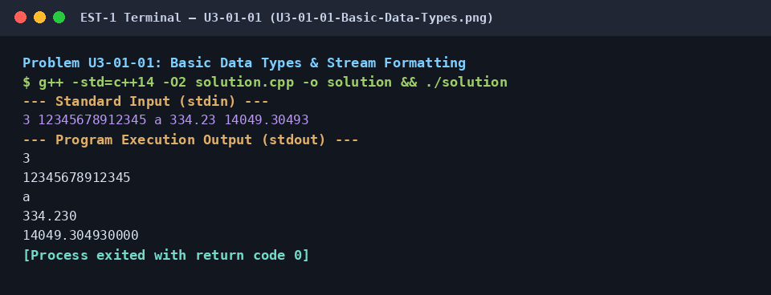

## `U3-02-01` — Conditional Statements in C++
- **Topic:** 02. Control Flow & Decision Logic
- **Image File:** [`U3-02-01-Conditional-Statements.png`](U3-02-01-Conditional-Statements.png)

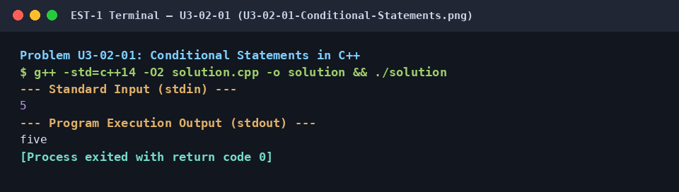

## `U3-03-01` — 2D Array - DS (Hourglass Sum)
- **Topic:** 03. Linear & Multi-Dimensional Arrays
- **Image File:** [`U3-03-01-2D-Hourglass-Sum.png`](U3-03-01-2D-Hourglass-Sum.png)

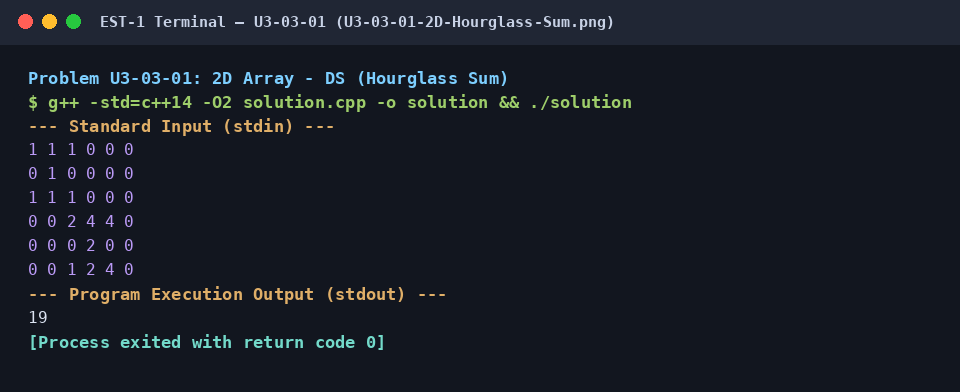

## `U3-03-02` — 2D Array Spiral Traversal (Interactive Visualizer)
- **Topic:** 03. Linear & Multi-Dimensional Arrays
- **Image File:** [`U3-03-02-Matrix-Spiral-Traversal.png`](U3-03-02-Matrix-Spiral-Traversal.png)

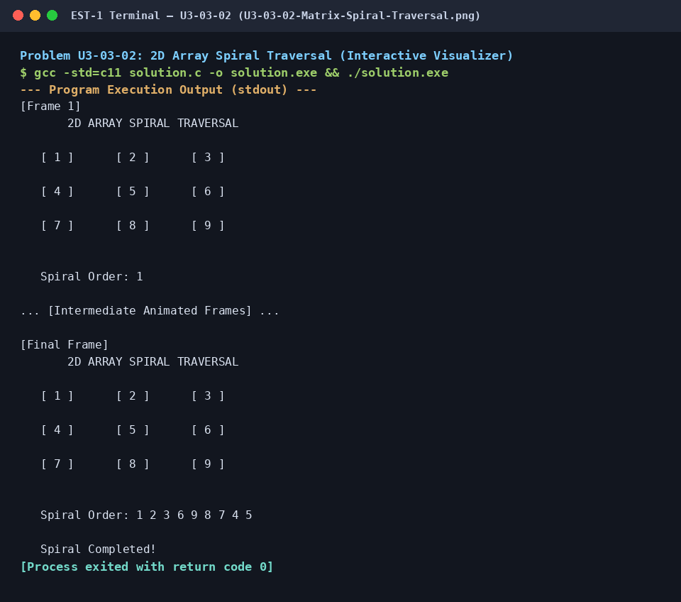

## `U3-04-01` — Super Reduced String (Stack-Based Adjacent Cancellation)
- **Topic:** 04. Strings & Lexical Processing
- **Image File:** [`U3-04-01-Super-Reduced-String.png`](U3-04-01-Super-Reduced-String.png)

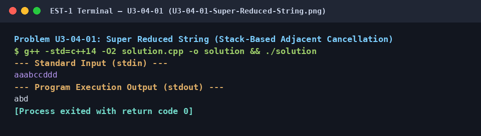

## `U3-05-01` — Pointers in C/C++ (In-Place Memory Mutation)
- **Topic:** 05. Memory & Pointer Mechanics
- **Image File:** [`U3-05-01-Pointers-in-C.png`](U3-05-01-Pointers-in-C.png)

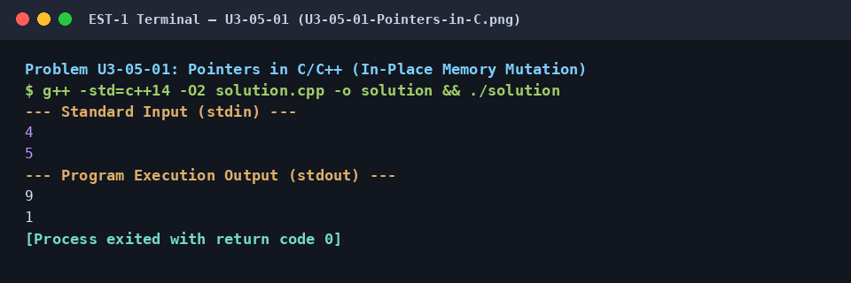

## `U3-06-01` — Dynamic Array (XOR Sequence Query Dispatch)
- **Topic:** 06. Dynamic Arrays
- **Image File:** [`U3-06-01-Dynamic-Array.png`](U3-06-01-Dynamic-Array.png)

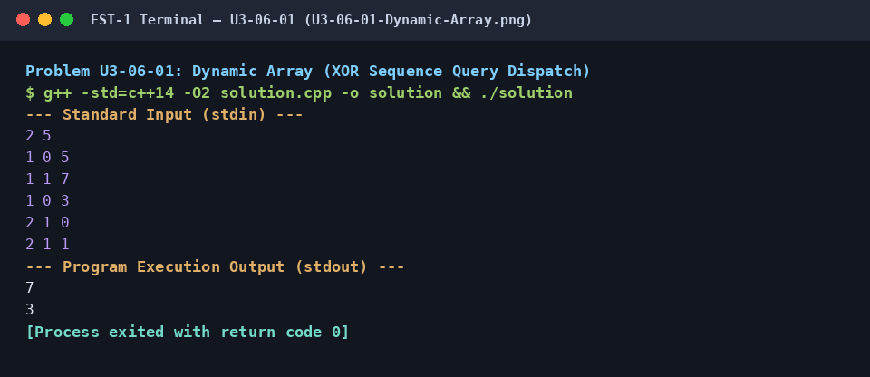

## `U3-07-01` — Array Manipulation (Difference Array & Prefix Sums)
- **Topic:** 07. Pre-computation & Range Techniques
- **Image File:** [`U3-07-01-Array-Manipulation.png`](U3-07-01-Array-Manipulation.png)

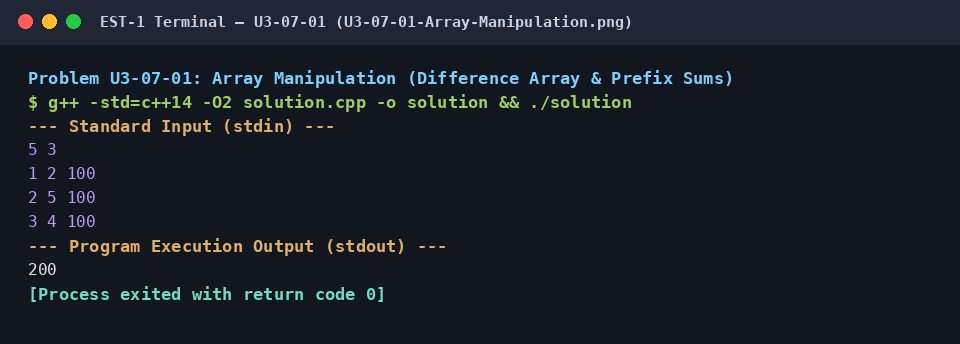

## `U3-08-01` — Max Min (Minimum Unfairness via Greedy Sliding Window)
- **Topic:** 08. Sliding Windows & Greedy Paradigms
- **Image File:** [`U3-08-01-Max-Min.png`](U3-08-01-Max-Min.png)

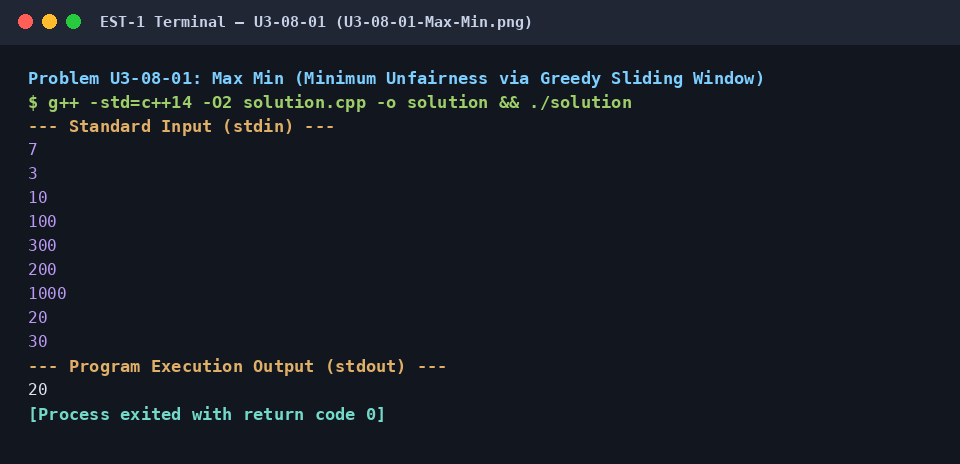

## `U3-08-02` — Sliding Window Sum (Console Simulation)
- **Topic:** 08. Sliding Windows & Greedy Paradigms
- **Image File:** [`U3-08-02-Sliding-Window-Visualizer.png`](U3-08-02-Sliding-Window-Visualizer.png)

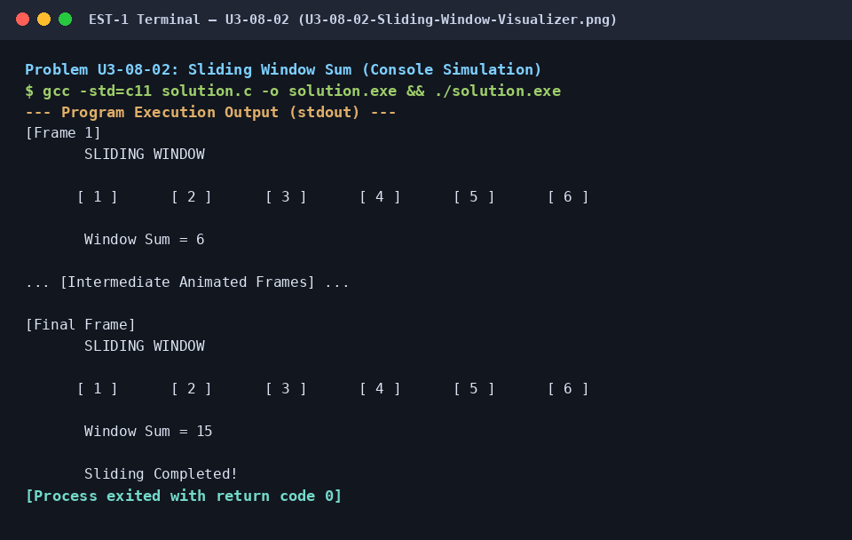

## `U3-09-01` — Counting Sort 1 (Frequency Array Bucketing)
- **Topic:** 09. Bucketing & Frequency Arrays
- **Image File:** [`U3-09-01-Counting-Sort-1.png`](U3-09-01-Counting-Sort-1.png)

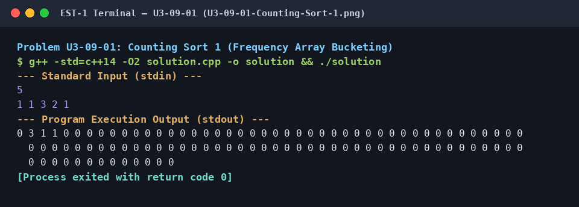

## `U3-10-01` — Tower of Hanoi (Visual Recursive Simulation)
- **Topic:** 10. Recursion & Combinatorics
- **Image File:** [`U3-10-01-Tower-of-Hanoi-Visualizer.png`](U3-10-01-Tower-of-Hanoi-Visualizer.png)

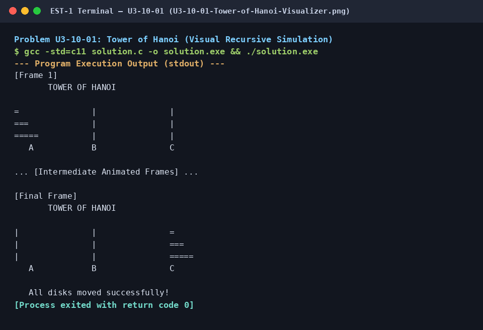

## `U3-10-02` — Recursive Digit Sum (Super Digit)
- **Topic:** 10. Recursion & Combinatorics
- **Image File:** [`U3-10-02-Recursive-Digit-Sum.png`](U3-10-02-Recursive-Digit-Sum.png)

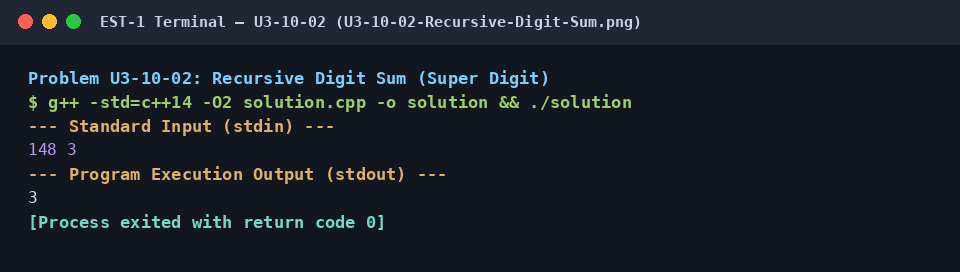

## `U3-11-01` — Sieve of Eratosthenes (Animated Composite Elimination)
- **Topic:** 11. Complexity & Sorting Analysis
- **Image File:** [`U3-11-01-Sieve-of-Eratosthenes-Visualizer.png`](U3-11-01-Sieve-of-Eratosthenes-Visualizer.png)

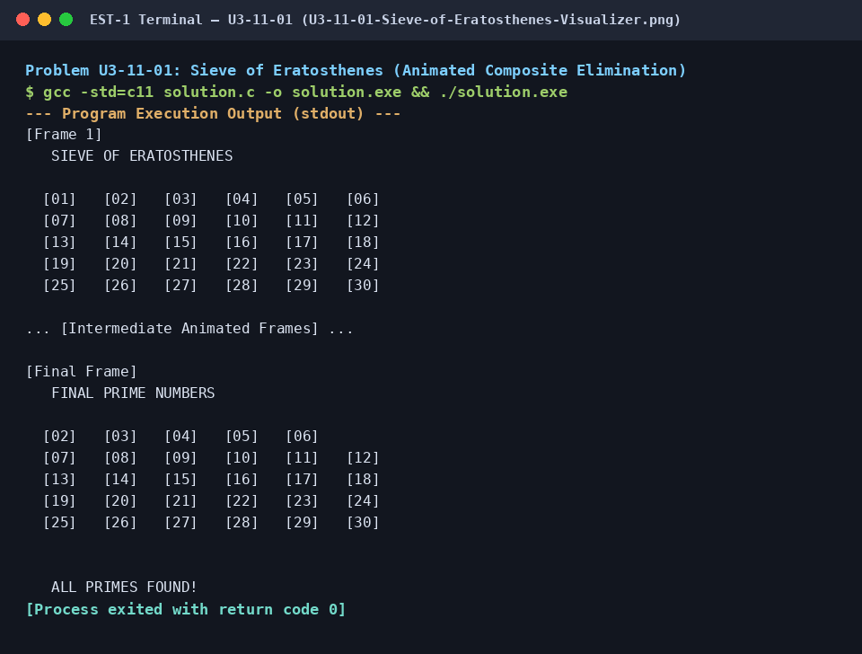

## `U3-11-02` — Running Time of Algorithms (Insertion Sort Shift & Inversion Counting)
- **Topic:** 11. Complexity & Sorting Analysis
- **Image File:** [`U3-11-02-Running-Time-Insertion-Sort.png`](U3-11-02-Running-Time-Insertion-Sort.png)

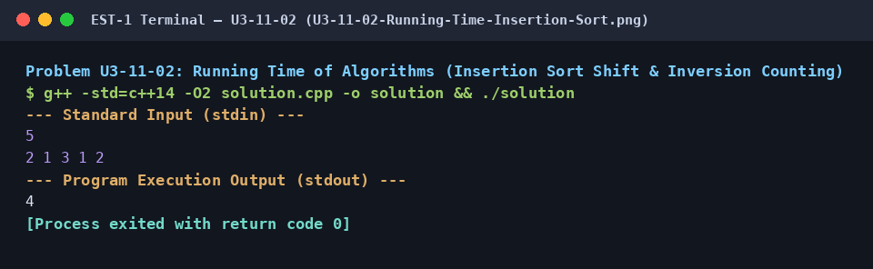

## `U4-01-01` — Restaurant (Optimal Square Tiling via Euclidean GCD)
- **Topic:** 01. Greatest Common Divisor & Area Tiling
- **Image File:** [`U4-01-01-Restaurant-Tiling.png`](U4-01-01-Restaurant-Tiling.png)

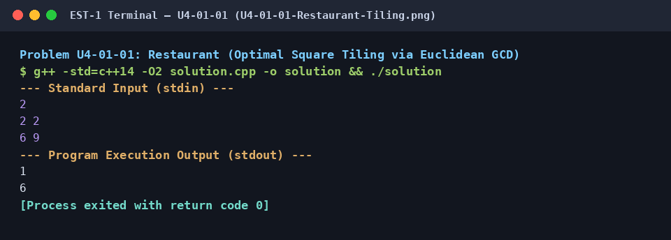

## `U4-02-01` — Segmented Sieve (Range Prime Generation)
- **Topic:** 02. Number Theory & Multiples
- **Image File:** [`U4-02-01-Segmented-Sieve-Visualizer.png`](U4-02-01-Segmented-Sieve-Visualizer.png)

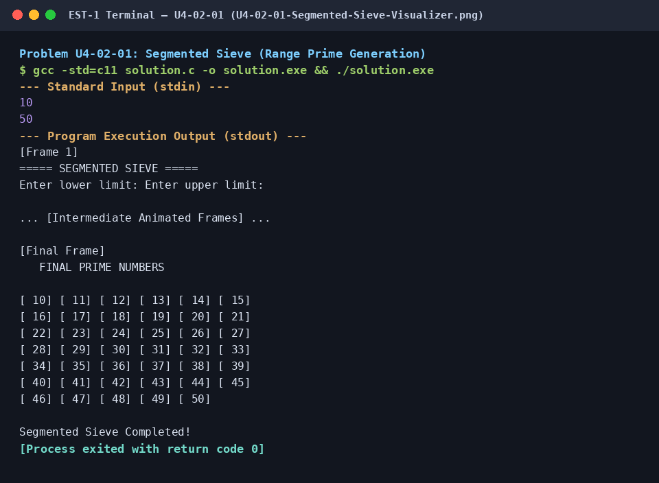

## `U4-02-02` — Between Two Sets (LCM & GCD Constraints)
- **Topic:** 02. Number Theory & Multiples
- **Image File:** [`U4-02-02-Between-Two-Sets.png`](U4-02-02-Between-Two-Sets.png)

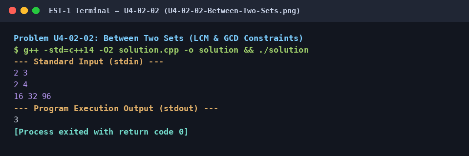

## `U4-03-01` — Modular Exponentiation & Fermat's Little Theorem
- **Topic:** 03. Modular Arithmetic
- **Image File:** [`U4-03-01-Modular-Exponentiation.png`](U4-03-01-Modular-Exponentiation.png)

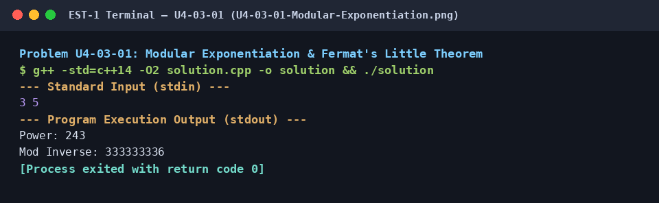

## `U4-04-01` — Permutations and Combinations (nPr & nCr Evaluator)
- **Topic:** 04. Permutations & Combinations
- **Image File:** [`U4-04-01-Permutations-and-Combinations.png`](U4-04-01-Permutations-and-Combinations.png)

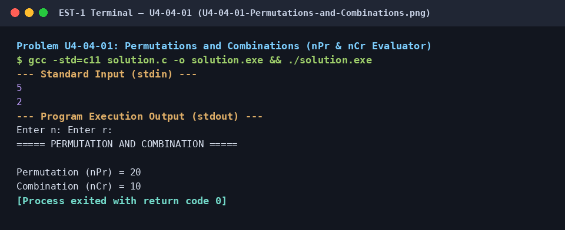

## `U4-04-02` — Handshake (Complete Graph Combinatorics)
- **Topic:** 04. Permutations & Combinations
- **Image File:** [`U4-04-02-Handshake.png`](U4-04-02-Handshake.png)

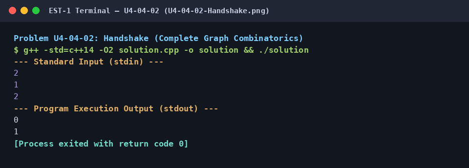

## `U4-05-01` — Pascal's Triangle (Dynamic Binomial Coefficient Computation)
- **Topic:** 05. Pascal's Triangle
- **Image File:** [`U4-05-01-Pascals-Triangle.png`](U4-05-01-Pascals-Triangle.png)

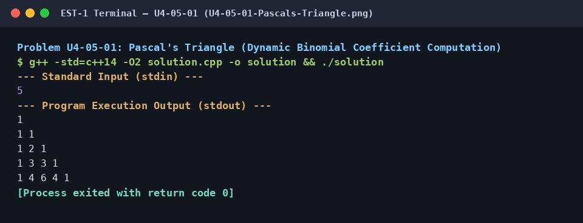
