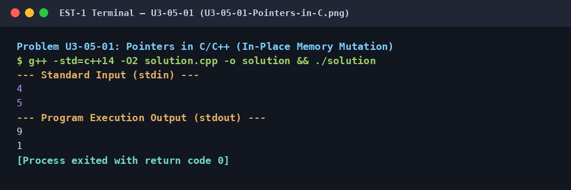

# Pointers in C/C++ (In-Place Memory Mutation)

## 1. Problem Title
- **Title:** Pointers in C/C++ (In-Place Memory Mutation)
- **Problem ID:** `U3-05-01`
- **Topic Section:** 05. Memory & Pointer Mechanics
- **Difficulty:** Easy
- **Language:** C++14
- **Status:** Completed (Uploaded C++14)

## 2. HackerRank Problem Link
- **HackerRank Link:** [Pointers in C](https://www.hackerrank.com/challenges/pointer-in-c/problem)

## 3. Problem Statement Summary
Implement a function `void update(int *a, int *b)` that receives pointers to two integers and modifies their values in-place so that `*a` holds their sum (`a + b`) and `*b` holds their absolute difference (`|a - b|`).

## 4. Objective
Understand C/C++ memory addressing (`&`), pointer dereferencing (`*`), and temporary staging during in-place mutations.

## 5. Algorithm
1. Read two integers `a` and `b` in `main()`.
2. Pass their memory addresses `&a` and `&b` to `update(int *a, int *b)`.
3. Inside `update`, dereference `*a` and `*b` to compute `int sum = *a + *b` and `int diff = std::abs(*a - *b)` in temporary local variables.
4. Write `sum` into `*a` and `diff` into `*b`.
5. Print the updated `a` and `b` in `main()`.

## 6. Step-by-Step Procedure
1. **Step 1 (Address Passing):** Call `update(&a, &b)` using the address-of operator `&` so `update` receives pointers to `a` and `b`'s stack memory.
2. **Step 2 (Dereference & Stage):** Compute `sum = *a + *b` and `diff = std::abs(*a - *b)` before overwriting `*a` (otherwise overwriting `*a` first would corrupt the calculation of `*b`).
3. **Step 3 (In-Place Mutation):** Assign `*a = sum` and `*b = diff`.
4. **Step 4 (Output):** Print the modified values of `a` and `b` on separate lines.

## 7. C++ Source Code (`solution.cpp`)
```cpp
#include <iostream>
#include <cmath>

void update(int *a, int *b) {
    int sum = *a + *b;
    int diff = std::abs(*a - *b);
    *a = sum;
    *b = diff;
}

int main() {
    std::ios_base::sync_with_stdio(false);
    std::cin.tie(NULL);

    int a, b;
    if (std::cin >> a >> b) {
        update(&a, &b);
        std::cout << a << "\n" << b << "\n";
    }

    return 0;
}
```

## 8. Sample Input and Output

### Sample Input
```text
4
5
```

### Sample Output
```text
9
1
```

## 9. Time Complexity
- **Time Complexity:** `O(1)`

## 10. Auxiliary Space Complexity
- **Auxiliary Space Complexity:** `O(1)`

## 11. Explanation of the Program
A function with a `void` return type cannot return two values normally, but by accepting pointer parameters `int *a` and `int *b`, it directly accesses and mutates the caller's variables in memory. Storing `sum` and `diff` in temporary variables before assigning `*a = sum` ensures the original value of `*a` is still intact when computing `std::abs(*a - *b)`.

## 12. Execution Output Screenshot

