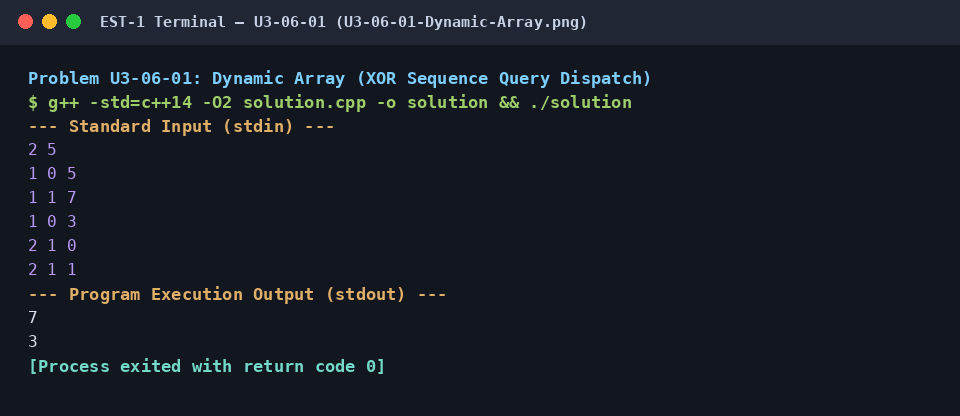

# Dynamic Array (XOR Sequence Query Dispatch)

## 1. Problem Title
- **Title:** Dynamic Array (XOR Sequence Query Dispatch)
- **Problem ID:** `U3-06-01`
- **Topic Section:** 06. Dynamic Arrays
- **Difficulty:** Easy
- **Language:** C++14
- **Status:** Completed (Uploaded C++14)

## 2. HackerRank Problem Link
- **HackerRank Link:** [Dynamic Array](https://www.hackerrank.com/challenges/dynamic-array/problem)

## 3. Problem Statement Summary
Maintain `n` initially empty dynamic sequences (`arr[0..n-1]`) and an integer `lastAnswer = 0`. Process `q` queries of two types using bitwise XOR indexing `idx = (x ^ lastAnswer) % n`: Type 1 appends `y` to `arr[idx]`, and Type 2 sets `lastAnswer = arr[idx][y % arr[idx].size()]` and prints it.

## 4. Objective
Use `std::vector<std::vector<int>>` for variable-length 2D dynamic arrays, amortized `O(1)` `push_back` expansion, and stateful bitwise XOR query routing.

## 5. Algorithm
1. Read `n` (number of sequences) and `q` (number of queries).
2. Instantiate `std::vector<std::vector<int>> arr(n)` and initialize `lastAnswer = 0`.
3. For each query `(type, x, y)`, compute the target sequence index `idx = (x ^ lastAnswer) % n`.
4. If `type == 1`, append `y` to `arr[idx]` via `arr[idx].push_back(y)`.
5. If `type == 2`, compute element offset `y % arr[idx].size()`, update `lastAnswer = arr[idx][y % arr[idx].size()]`, and print `lastAnswer`.

## 6. Step-by-Step Procedure
1. **Step 1 (Dynamic Container Allocation):** Create a vector of `n` empty vectors `std::vector<std::vector<int>> arr(n)`.
2. **Step 2 (XOR Index Calculation):** In each query, combine `x` and `lastAnswer` with the bitwise XOR operator `^` and take modulo `n`.
3. **Step 3 (Query Execution):** Dispatch on `type == 1` (append `y`) or `type == 2` (fetch element at `y % arr[idx].size()`, update `lastAnswer`, and output).

## 7. C++ Source Code (`solution.cpp`)
```cpp
#include <iostream>
#include <vector>

int main() {
    std::ios_base::sync_with_stdio(false);
    std::cin.tie(NULL);

    int n, q;
    if (std::cin >> n >> q) {
        std::vector<std::vector<int>> arr(n);
        int lastAnswer = 0;

        for (int i = 0; i < q; ++i) {
            int type, x, y;
            std::cin >> type >> x >> y;
            int idx = (x ^ lastAnswer) % n;

            if (type == 1) {
                arr[idx].push_back(y);
            } else if (type == 2) {
                lastAnswer = arr[idx][y % arr[idx].size()];
                std::cout << lastAnswer << "\n";
            }
        }
    }

    return 0;
}
```

## 8. Sample Input and Output

### Sample Input
```text
2 5
1 0 5
1 1 7
1 0 3
2 1 0
2 1 1
```

### Sample Output
```text
7
3
```

## 9. Time Complexity
- **Time Complexity:** `O(Q)`

## 10. Auxiliary Space Complexity
- **Auxiliary Space Complexity:** `O(N + Q)`

## 11. Explanation of the Program
Because we do not know in advance how many elements will be pushed into each of the `n` sequences, a fixed 2D array would either waste memory or overflow. Using `std::vector<std::vector<int>> arr(n)` gives each row independent dynamic capacity that grows on demand in amortized `O(1)` time per `push_back`.

## 12. Execution Output Screenshot

