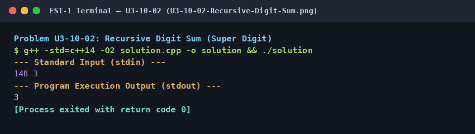

# Recursive Digit Sum (Super Digit)

## 1. Problem Title
- **Title:** Recursive Digit Sum (Super Digit)
- **Problem ID:** `U3-10-02`
- **Topic Section:** 10. Recursion & Combinatorics
- **Difficulty:** Medium
- **Language:** C++14
- **Status:** Completed (Uploaded C++14)

## 2. HackerRank Problem Link
- **HackerRank Link:** [Recursive Digit Sum](https://www.hackerrank.com/challenges/recursive-digit-sum/problem)

## 3. Problem Statement Summary
Given a large integer represented as a string `n` (up to `10^100000` digits) and a repetition factor `k` (up to `10^5`), compute the super digit of the number formed by concatenating `n` exactly `k` times.

## 4. Objective
Use string digit summation and recursive base-case reduction (`val < 10`) to compute the super digit without constructing an impossibly large concatenated string.

## 5. Algorithm
1. Read string `n` and 64-bit repetition count `k`.
2. Compute `initial_sum` by summing `(ch - '0')` for every character `ch` in `n`.
3. Multiply `initial_sum *= k` to account for `n` being repeated `k` times.
4. Call recursive helper `super_digit(val)`: if `val < 10`, return `val`; otherwise sum the base-10 digits of `val` using `val % 10` and `val /= 10`, and return `super_digit(sum)`.

## 6. Step-by-Step Procedure
1. **Step 1 (String Digit Reduction):** Since `n` can have `100,000` digits, it cannot fit in any primitive integer type. Sum its characters directly (`ch - '0'`) into a `long long initial_sum`.
2. **Step 2 (Concatenation Factor):** Multiply `initial_sum` by `k` (even for `10^5` nines repeated `10^5` times, `9 * 10^10` fits comfortably inside a 64-bit `long long`).
3. **Step 3 (Recursive Collapse):** Recursively sum the digits of `val` until a single digit (`< 10`) is reached.

## 7. C++ Source Code (`solution.cpp`)
```cpp
#include <iostream>
#include <string>

long long super_digit(long long val) {
    if (val < 10) return val;
    long long sum = 0;
    while (val > 0) {
        sum += val % 10;
        val /= 10;
    }
    return super_digit(sum);
}

int main() {
    std::ios_base::sync_with_stdio(false);
    std::cin.tie(NULL);

    std::string n;
    long long k;
    if (std::cin >> n >> k) {
        long long initial_sum = 0;
        for (char ch : n) {
            initial_sum += (ch - '0');
        }
        initial_sum *= k;
        std::cout << super_digit(initial_sum) << "\n";
    }

    return 0;
}
```

## 8. Sample Input and Output

### Sample Input
```text
148 3
```

### Sample Output
```text
3
```

## 9. Time Complexity
- **Time Complexity:** `O(|n| + log10(sum))`

## 10. Auxiliary Space Complexity
- **Auxiliary Space Complexity:** `O(log10(sum)) recursion stack`

## 11. Explanation of the Program
Actually concatenating a `100,000`-character string `100,000` times would require `10 GB` of RAM. Instead, because the sum of digits of `n` repeated `k` times is simply `k * sum_of_digits(n)`, we sum the digits of `n` in one linear scan, multiply by `k` using 64-bit `long long`, and then recursively sum the digits in at most 3–4 stack frames.

## 12. Execution Output Screenshot

