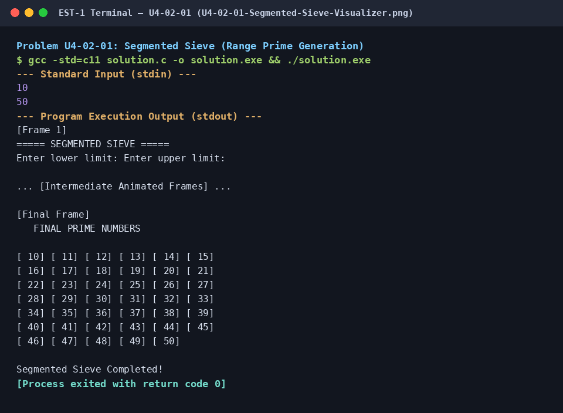

# Segmented Sieve (Range Prime Generation)

## 1. Problem Title
- **Title:** Segmented Sieve (Range Prime Generation)
- **Problem ID:** `U4-02-01`
- **Topic Section:** 02. Number Theory & Multiples
- **Difficulty:** Medium
- **Language:** C (Uploaded Visualizer)
- **Status:** Completed (Uploaded C Visualizer)

## 2. HackerRank Problem Link
- **HackerRank Link:** Pending Verification (Uploaded Console Visualizer)

## 3. Problem Statement Summary
Find all prime numbers within an arbitrary interval `[low, high]` using a Segmented Sieve that first computes base primes up to `sqrt(high)` and then eliminates their multiples inside `[low, high]`.

## 4. Objective
Generate primes in a bounded window `[low, high]` using `O(high - low + 1)` segment memory instead of `O(high)` full-sieve memory.

## 5. Algorithm
1. Read `low` and `high` and compute `limit = floor(sqrt(high))`.
2. Run a standard Sieve of Eratosthenes on `base[2..limit]` to find all base primes `p <= sqrt(high)`.
3. Initialize `segment[0 .. high - low]` to `1` (handling `0` and `1` explicitly if `low <= 1`).
4. For each base prime `p <= limit`, compute the first multiple of `p` inside `[low, high]` as `start = max(p * p, ((low + p - 1) / p) * p)`.
5. Mark `segment[j - low] = 0` for `j = start, start + p, ... <= high` while animating the console state.

## 6. Step-by-Step Procedure
1. **Step 1 (Base Prime Pre-computation):** Find all primes up to `sqrt(high)` in `base[]`.
2. **Step 2 (Offset Alignment):** For each base prime `p`, use ceiling division `((low + p - 1) / p) * p` to jump directly to the smallest multiple of `p` that is `>= low` (or `p * p` if larger).
3. **Step 3 (Window Sieving):** Cross off multiples shifted by `-low` (`segment[j - low] = 0`) and display remaining primes.

## 7. C++ Source Code (`solution.c`)
```c
#include <stdio.h>
#include <math.h>
#include <windows.h>
#include <stdlib.h>

#define MAX 1000

int main()
{
    int low, high;
    int base[MAX] = {0};
    int segment[MAX] = {0};

    HANDLE h = GetStdHandle(STD_OUTPUT_HANDLE);

    printf("===== SEGMENTED SIEVE =====\n");

    printf("Enter lower limit: ");
    scanf("%d", &low);

    printf("Enter upper limit: ");
    scanf("%d", &high);

    if (low < 0 || high < low || high > MAX)
    {
        printf("Invalid range! Use 0 to 1000.\n");
        return 0;
    }

    int limit = (int)sqrt(high);

    // Find prime numbers up to sqrt(high)
    for (int i = 2; i <= limit; i++)
        base[i] = 1;

    for (int i = 2; i * i <= limit; i++)
    {
        if (base[i])
        {
            for (int j = i * i; j <= limit; j += i)
                base[j] = 0;
        }
    }

    // Mark all numbers in the requested range
    for (int i = 0; i < high - low + 1; i++)
        segment[i] = 1;

    if (low == 0)
        segment[0] = 0;

    if (low <= 1 && high >= 1)
        segment[1 - low] = 0;

    // Eliminate multiples of base primes
    for (int p = 2; p <= limit; p++)
    {
        if (base[p])
        {
            int start = ((low + p - 1) / p) * p;

            if (start < p * p)
                start = p * p;

            for (int j = start; j <= high; j += p)
            {
                segment[j - low] = 0;

                system("cls");

                SetConsoleTextAttribute(h, 14);
                printf("\n   SEGMENTED SIEVE - PROCESSING\n\n");

                SetConsoleTextAttribute(h, 11);
                printf("Current base prime: %d\n\n", p);

                for (int k = 0; k <= high - low; k++)
                {
                    int num = low + k;

                    if (num == j)
                        SetConsoleTextAttribute(h, 12);
                    else if (segment[k])
                        SetConsoleTextAttribute(h, 10);
                    else
                        SetConsoleTextAttribute(h, 8);

                    printf("[%3d] ", num);

                    if ((k + 1) % 6 == 0)
                        printf("\n");
                }

                Sleep(250);
            }
        }
    }

    // Display final prime numbers
    system("cls");

    SetConsoleTextAttribute(h, 14);
    printf("\n   FINAL PRIME NUMBERS\n\n");

    for (int i = 0; i <= high - low; i++)
    {
        if (segment[i])
            SetConsoleTextAttribute(h, 10);
        else
            SetConsoleTextAttribute(h, 12);

        printf("[%3d] ", low + i);

        if ((i + 1) % 6 == 0)
            printf("\n");
    }

    SetConsoleTextAttribute(h, 7);
    printf("\n\nSegmented Sieve Completed!\n");

    return 0;
}
```

## 8. Sample Input and Output

### Sample Input
```text
Enter lower limit: 10
Enter upper limit: 50
```

### Sample Output
```text
Primes highlighted in green: 11, 13, 17, 19, 23, 29, 31, 37, 41, 43, 47
Segmented Sieve Completed!
```

## 9. Time Complexity
- **Time Complexity:** `O((high - low + 1) log log high + sqrt(high) log log sqrt(high))`

## 10. Auxiliary Space Complexity
- **Auxiliary Space Complexity:** `O(high - low + 1)`

## 11. Explanation of the Program
This is your original uploaded C Segmented Sieve program preserved verbatim. Rather than sieving from `2` all the way to `high`, it only sieves base primes up to `sqrt(high)` and uses the offset formula `((low + p - 1) / p) * p` to jump straight into the target interval `[low, high]`.

## 12. Execution Output Screenshot

