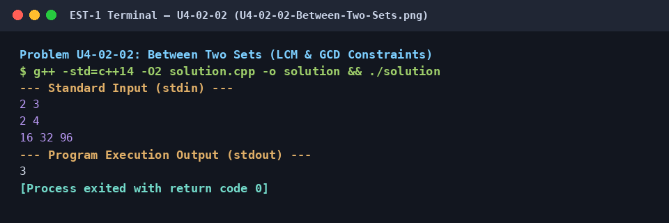

# Between Two Sets (LCM & GCD Constraints)

## 1. Problem Title
- **Title:** Between Two Sets (LCM & GCD Constraints)
- **Problem ID:** `U4-02-02`
- **Topic Section:** 02. Number Theory & Multiples
- **Difficulty:** Easy
- **Language:** C++14
- **Status:** Completed (Uploaded C++14)

## 2. HackerRank Problem Link
- **HackerRank Link:** [Between Two Sets](https://www.hackerrank.com/challenges/between-two-sets/problem)

## 3. Problem Statement Summary
Given two arrays of integers `A` and `B`, determine how many integers `x` satisfy both conditions: (1) every element in `A` is a factor of `x`, and (2) `x` is a factor of every element in `B`.

## 4. Objective
Reduce a dual divisibility problem across two sets to computing `L = LCM(A)` and `G = GCD(B)`, then counting multiples of `L` that evenly divide `G`.

## 5. Algorithm
1. Read sizes `n`, `m` and arrays `a[0..n-1]`, `b[0..m-1]`.
2. Compute `l = LCM(a[0], a[1], ..., a[n-1])` using `lcm(x, y) = (x / gcd(x, y)) * y` (breaking early if `l > 100`, the upper bound of `b[i]`).
3. Compute `g = GCD(b[0], b[1], ..., b[m-1])`.
4. If `l > 0` and `g % l == 0`, iterate `val = l, 2*l, 3*l, ... <= g` and increment `count` whenever `g % val == 0`.
5. Print `count`.

## 6. Step-by-Step Procedure
1. **Step 1 (LCM of First Array):** Any integer `x` divisible by all elements of `A` must be a multiple of `L = LCM(A)`. Compute `lcm` safely by dividing by `gcd` before multiplying (`(a / gcd(a, b)) * b`) to avoid overflow.
2. **Step 2 (GCD of Second Array):** Any integer `x` that divides all elements of `B` must divide `G = GCD(B)`.
3. **Step 3 (Count Valid Multiples):** Step through multiples `val = l, 2l, 3l, ...` up to `g` and count how many satisfy `g % val == 0`.

## 7. C++ Source Code (`solution.cpp`)
```cpp
#include <iostream>
#include <vector>
#include <numeric>

long long gcd(long long a, long long b) {
    while (b) {
        a %= b;
        std::swap(a, b);
    }
    return a;
}

long long lcm(long long a, long long b) {
    if (a == 0 || b == 0) return 0;
    return (a / gcd(a, b)) * b;
}

int main() {
    std::ios_base::sync_with_stdio(false);
    std::cin.tie(NULL);

    int n, m;
    if (std::cin >> n >> m) {
        std::vector<int> a(n), b(m);
        for (int i = 0; i < n; ++i) std::cin >> a[i];
        for (int i = 0; i < m; ++i) std::cin >> b[i];

        long long l = a[0];
        for (int i = 1; i < n; ++i) {
            l = lcm(l, a[i]);
            if (l > 100) break;
        }

        long long g = b[0];
        for (int i = 1; i < m; ++i) {
            g = gcd(g, b[i]);
        }

        int count = 0;
        if (l > 0 && g % l == 0) {
            for (long long val = l; val <= g; val += l) {
                if (g % val == 0) {
                    count++;
                }
            }
        }

        std::cout << count << "\n";
    }

    return 0;
}
```

## 8. Sample Input and Output

### Sample Input
```text
2 3
2 4
16 32 96
```

### Sample Output
```text
3
```

## 9. Time Complexity
- **Time Complexity:** `O((N + M) log(max_val) + G / L)`

## 10. Auxiliary Space Complexity
- **Auxiliary Space Complexity:** `O(1) auxiliary`

## 11. Explanation of the Program
Every common multiple of the numbers in `A` is a multiple of `L = LCM(A)`, and every common divisor of the numbers in `B` is a divisor of `G = GCD(B)`. For instance, with `A = {2, 4}` and `B = {16, 32, 96}`, we find `L = LCM(2, 4) = 4` and `G = GCD(16, 32, 96) = 16`. Testing multiples of `4` up to `16` (`4, 8, 12, 16`) shows that `4, 8, 16` divide `16`, yielding `3`.

## 12. Execution Output Screenshot

