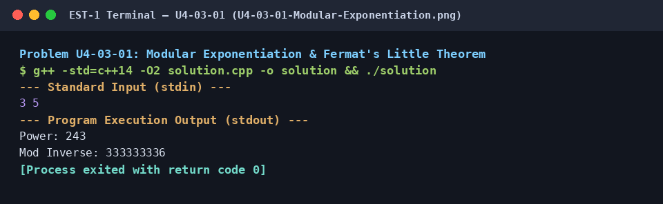

# Modular Exponentiation & Fermat's Little Theorem

## 1. Problem Title
- **Title:** Modular Exponentiation & Fermat's Little Theorem
- **Problem ID:** `U4-03-01`
- **Topic Section:** 03. Modular Arithmetic
- **Difficulty:** Medium
- **Language:** C++14
- **Status:** Completed (Uploaded C++14)

## 2. HackerRank Problem Link
- **HackerRank Link:** Pending Verification (Core C++14 Reference Module)

## 3. Problem Statement Summary
Given a `base` and `exp`, compute `(base^exp) % (10^9 + 7)` using binary exponentiation in `O(log exp)` time, and compute the modular multiplicative inverse `base^(-1) % (10^9 + 7)` via Fermat's Little Theorem (`base^(MOD - 2) % MOD`).

## 4. Objective
Master binary exponentiation (exponentiation by squaring) for large power calculations and Fermat's Little Theorem for modular division under a prime modulus.

## 5. Algorithm
1. Set prime modulus `MOD = 1000000007`.
2. In `power(base, exp)`: initialize `res = 1` and reduce `base %= MOD`.
3. While `exp > 0`: if `exp` is odd (`exp % 2 == 1`), multiply `res = (res * base) % MOD`; square `base = (base * base) % MOD` and halve `exp /= 2`.
4. In `mod_inverse(n)`: return `power(n, MOD - 2)`.
5. Read `base` and `exp`, then output `Power: <power(base, exp)>` and `Mod Inverse: <mod_inverse(base)>`.

## 6. Step-by-Step Procedure
1. **Step 1 (Modulo Reduction):** Reduce `base %= MOD` upfront so `base * base` never overflows a 64-bit `long long` (`(10^9 + 7)^2 approx 10^18 < 9.22 * 10^18`).
2. **Step 2 (Binary Exponentiation Loop):** Inspect the lowest bit of `exp` in each step. Multiply `res` by the current `base` power whenever the bit is `1`, and square `base` each iteration as `exp` is halved.
3. **Step 3 (Fermat's Little Theorem):** Since `MOD = 10^9 + 7` is prime, `a^(MOD - 1) === 1 (mod MOD)` for any `a` not divisible by `MOD`. Multiplying both sides by `a^(-1)` yields `a^(-1) === a^(MOD - 2) (mod MOD)`.

## 7. C++ Source Code (`solution.cpp`)
```cpp
#include <iostream>

const long long MOD = 1000000007;

// Binary exponentiation: (base^exp) % mod
long long power(long long base, long long exp) {
    long long res = 1;
    base %= MOD;
    while (exp > 0) {
        if (exp % 2 == 1) res = (res * base) % MOD;
        base = (base * base) % MOD;
        exp /= 2;
    }
    return res;
}

// Modular inverse via Fermat's Little Theorem: a^(MOD-2) % MOD
long long mod_inverse(long long n) {
    return power(n, MOD - 2);
}

int main() {
    std::ios_base::sync_with_stdio(false);
    std::cin.tie(NULL);

    long long base, exp;
    if (std::cin >> base >> exp) {
        std::cout << "Power: " << power(base, exp) << "\n";
        std::cout << "Mod Inverse: " << mod_inverse(base) << "\n";
    }

    return 0;
}
```

## 8. Sample Input and Output

### Sample Input
```text
3 5
```

### Sample Output
```text
Power: 243
Mod Inverse: 333333336
```

## 9. Time Complexity
- **Time Complexity:** `O(log(exp))`

## 10. Auxiliary Space Complexity
- **Auxiliary Space Complexity:** `O(1)`

## 11. Explanation of the Program
Multiplying `base` by itself `exp` times takes `O(exp)` operations, which is too slow when `exp` is `10^9` or `MOD - 2 = 10^9 + 5`. Binary exponentiation decomposes `exp` into powers of 2, squaring `base` on each step and finishing in at most `~30` loop iterations (`log2(10^9) approx 30`). Notice that for `base = 3`, `(3 * 333333336) % 1000000007 = 1000000008 % 1000000007 = 1`, verifying that `333333336` is the exact modular inverse of `3`.

## 12. Execution Output Screenshot

